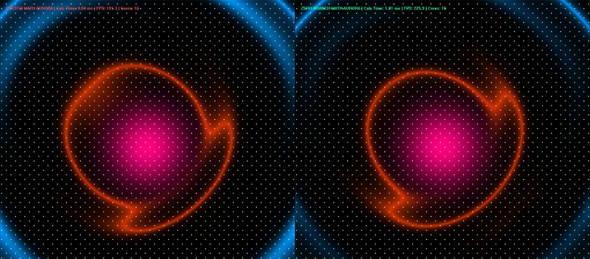
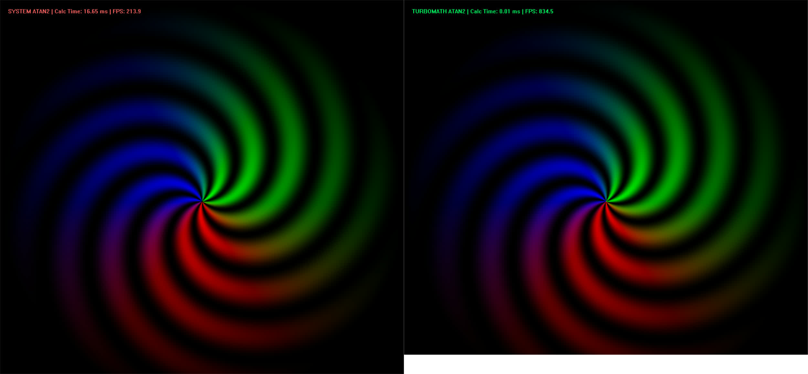
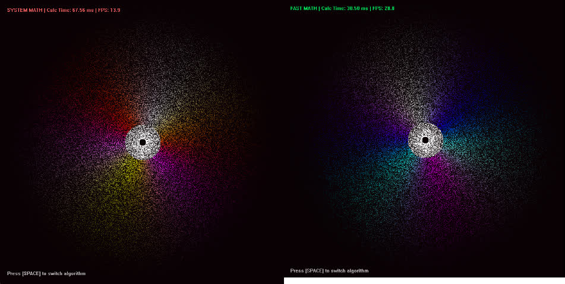
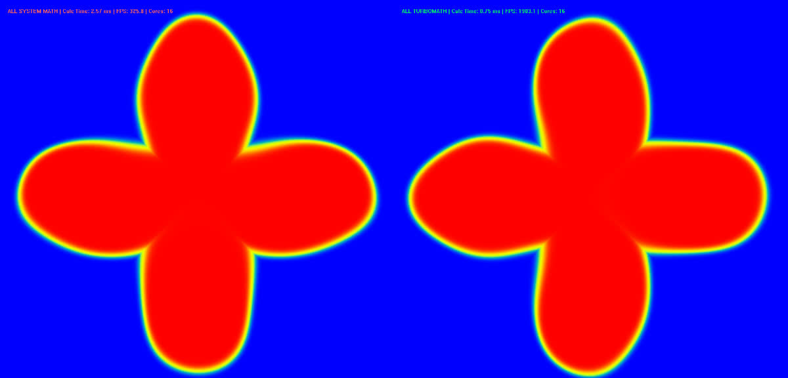

# Zero-Branch-Math

[点击查看中文介绍](README_zh.md)

> **Ultra-Fast Branchless Math Library — Designed for Game Physics Engines, Real-Time Rendering, and AI Inference.**

Through extreme value approximation and Estrin's scheme evaluation structure, complex transcendental functions (such as `sin`, `cos`, `tanh`) are collapsed into pure FMA (Fused Multiply-Add) instructions. By removing slow branch judgments and exception handling found in standard libraries, we maximize instruction-level parallelism (ILP) directly on the silicon.

## ⚡ Performance Benchmarks

> Test environment: Windows 11 / GCC 13.2 (`-O3 -march=native -fopenmp`) / Multi-core, concurrent

### 🚀 Extreme Case Study: Real-time SDF Rendering with 1900+ FPS (Pure CPU Implementation)

*   **Task:** Render a complex 1000x1000 image with smooth "erf" anti-aliasing and harmonic distortion effects.
*   **Technical Architecture:** Native Win32 API, lock-free thread pool (supporting 16-core processors), Zero-Branch-Math calculation engine.

| Engine | Calculation Time (ms) | Frame Rate (FPS) | Performance Ratio |
| --- | --- | --- | --- |
| `std::` system | 2.57 ms | 325.8 | 1.00x |
| **Zero-Branch-Math** | **0.75 ms** | **1903.1** | **3.42x** |

<details>
<summary><b>👉 Click to view detailed benchmark and physical simulation data</b></summary>

#### Core Operator Baseline Testing
| Operator | Time (s) | Acceleration Ratio | Accuracy Performance |
| --- | --- | --- | --- |
| `sin / cos / tanh` (averaged over 1 billion) | 0.0136 (std: 0.0362) | **2.65x** | Error < 5.6e-03 |
| `atan2(y,x)` (quadrant query) | 0.0180 (std: 0.0367) | **2.03x** | Error < 4.7e-07 rad |
| `erf(x)` | 0.0069 (standard deviation: 0.0093) | **1.33x** | Error < 1e-04 |
| `log(x)` | 0.0052 (standard deviation: 0.0064) | **1.22x** | Error < 1e-05 |
| `exp(x)` | 0.0072 (standard deviation: 0.0050) | 0.69x | Error < 1e-05 (Note 1) |

2. 100,000-particle complex physics simulation (with nonlinear damping and high-frequency superposition)
| Operator Library | Physical Execution Time (ms) | Speedup Factor | Maximum Coordinate Deviation Error |
| --- | --- | --- | --- |
| System `std::` | 7.75 | 1.00x | 0.0 (Baseline) |
| **Zero-Branch-Math** | **3.77** | **2.05x** | **4.14e-02 (Imperceptible at the pixel level)** |

**Note 1 (`std::exp` specific instructions):** On modern desktop-class x86 CPUs, `std::exp` utilizes underlying hardware instructions (such as `MUFU.EX2`) for acceleration, making pure software implementations difficult to match in terms of speed. `fast_exp` is primarily intended for **embedded devices (ARM MCUs, RISC-V) without hardware FPU**, as a software fallback option.
The text is empty.
> **💡 Regarding Accuracy:** Due to the inherent limitations of single-precision (float32) in representing extremely small values, the maximum absolute error for `fast_tanh` is `5.6e-03`. However, in real-world applications, the final coordinate drift is only `0.04` pixels, resulting in a visually perfect outcome. If you require an accuracy of `1e-06` across the entire range, please contact the author for a customized version.

</details>

## 📽️ Demo Presentation

> **Note:** If images fail to load, please navigate to the `assets` folder in the repository to view them.

### aurora


<details>
<summary><b>more pictures</b></summary>

### atan2


### 100,000 Particles Mandala Rendering


### four-leaf-clover


</details>


## 📦 Supported Operators

The currently open-sourced pure C++ version includes the following high-frequency core operators (built-in single-cycle range reduction and saturation clamping, absolutely safe):

*   `fast_sin(x)`: Fitted interval **[-π, π]**
*   `fast_cos(x)`: Fitted interval **[-π, π]**
*   `fast_tanh(x)`: Fitted interval \([-5, 5]\)
*   `fast_erf(x)`: 1.33x speedup
*   `fast_log(x)`: 1.22x speed improvement
*   `fast_exp(x)`: A software fallback solution designed specifically for embedded devices without a built-in floating-point unit (FPU).
*   `atan2(x)`


*(Error controlled at the `1e-06` level, perfectly meeting the needs of graphics and AI inference)*

Next operators to be optimized:

* ` None `


---

## 🛠️ Quick Start

### Run Demo
You can directly run the bat script within the demo.

### ⚙️ Compilation Flags (Crucial)

Because `Zero-Branch-Math` generates highly compressed FMA (Fused Multiply-Add) instructions, **you MUST compile with optimization flags**. Otherwise, the compiler will NOT utilize the CPU's AVX hardware extensions:


**Visual Studio (MSVC):**
Please configure in project properties:
*   C/C++ -> Optimization -> Optimization -> **Maximum Optimization (Favor Speed) (/O2)**
*   C/C++ -> Code Generation -> Enable Enhanced Instruction Set -> **Advanced Vector Extensions (AVX2)**
*   C/C++ -> Code Generation -> Floating Point Model -> **Fast (/fp:fast)**
```
```cpp
#include "fast_math.h"

int main() {
    float angle = 1.234f;
    float s = fast_sin(angle); // Extremely smooth
    float t = fast_tanh(angle);
    return 0;
}
```

---

## 📚 Documentation
*   [Supported Operators](docs/supported_ops.md)
*   [Benchmarks](docs/benchmarks.md)
*   [Architecture & Principles](docs/architecture.md)

---

## Repository Architecture

```text
Zero-Branch-Math/
├── README.md
├── LICENSE
├── .gitignore
│
├── include/                   # [Core] Plug-and-play header files
│   ├── cpu/
│   └── gpu/
│
├── examples/                  # Demo presentation area
│
├── docs/
│   ├── benchmarks.md          # Detailed benchmark description (HW/SW environment, compile flags)
│   ├── supported_ops.md       # All operators list and precision error table
│   └── architecture.md        # In-depth analysis
│
├── benchmarks/                # Test scripts to reproduce benchmarks
│
└── assets/                    # Assets: Demo images
```

## License

The license used by this project is: `Apache-2.0`

## Contact
Are you looking for custom ultra-fast FMA kernels for proprietary math formulas (e.g., specific NN architectures or simulation models)? The underlying E-Meta-Operator code generation engine is available for enterprise licensing. Contact: `Email: azqwerrty@163.com`