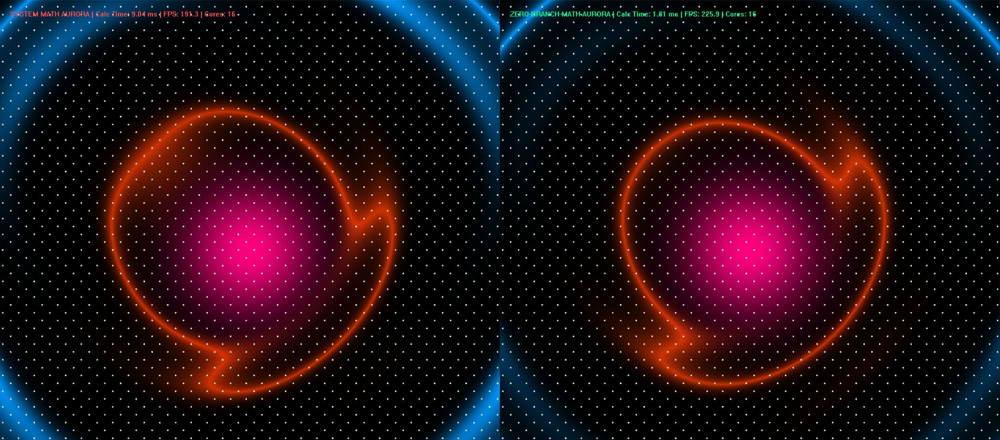
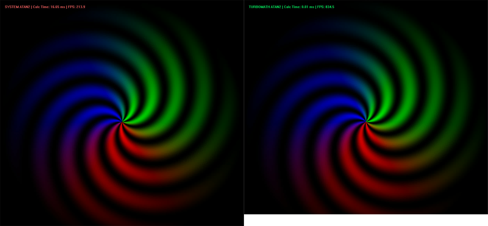
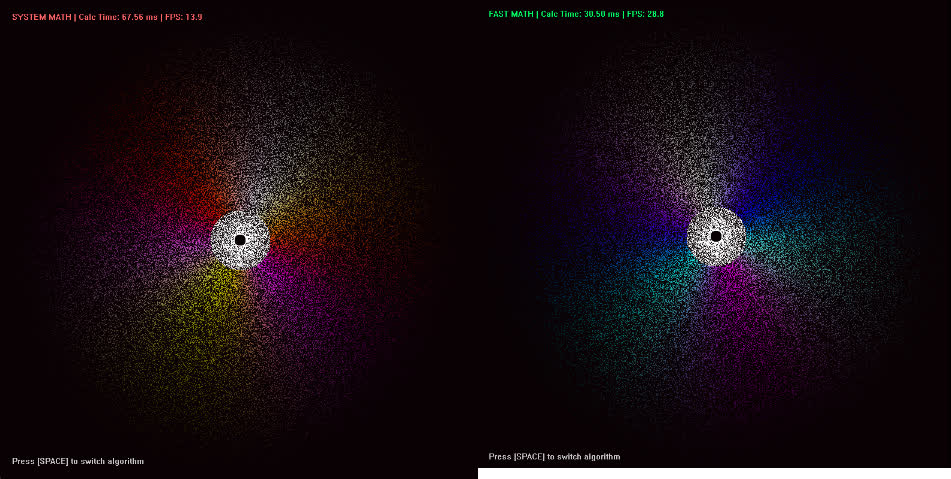
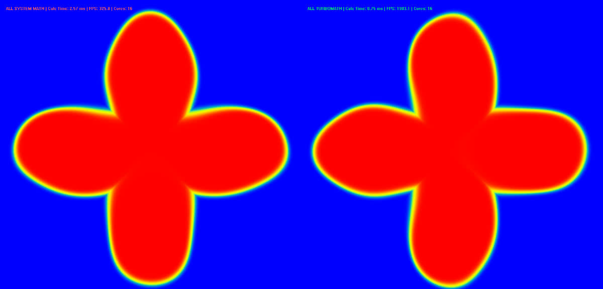

# Zero-Branch-Math

[English](README.md)

> **极速无分支数学库 —— 专为游戏物理引擎、实时渲染与 AI 推理设计。**
>
> 协议：`Apache-2.0`

通过极值逼近与 Estrin 树求值结构，将复杂的超越函数（如 `sin`, `cos`, `tanh`）坍缩为纯 FMA（乘加融合）指令。极大规避了标准库中冗余的分支判断，榨干硅片的每一滴算力。

## ⚡ 核心性能亮点

> **测试环境**：Windows 11 / GCC 13.2 (`-O3 -march=native`) / 原生多线程并发

得益于极简的纯 FMA 架构与编译器指令级优化，Zero-Branch-Math 在不改变全局编译参数的情况下，依然跑出极其恐怖的性能：

*   🚀 **基础数学函数** (`sin/cos/atan2`)：相比 `std::` 库，实现 **2x ~ 3x** 的算力碾压。
*   🚀 **AI 激活函数** (`erf/gelu/mish`)：消除冗长级数展开，实现 **1.5x ~ 7x** 的加速。
*   🚀 **物理引擎端到端集成**：在 10 万粒子复杂模拟中，实现 **2x** 以上的帧率提升。
*   🚀 **极限渲染**：纯 CPU 实时渲染 1000x1000 的 SDF，帧率突破 **1000 FPS**。

*(📊 查看具体耗时与精度误差：请参阅 [详细跑分报告](docs/benchmarks.md))*

## 🖼️ 视觉 Demo 演示

> 渲染均由原生 Win32 API + Zero-Branch-Math 驱动，纯 CPU 运算

### 动态极光星云 (Aurora)


<details>
<summary><b>👉 点击展开更多视觉演示</b></summary>

### atan2


### 10万粒子曼陀罗渲染


### 四叶草


</details>

## 📦 支持的算子

目前开源版本包含以下高频核心算子（内置周期规约与无分支饱和截断）：

| 算子名称 | 说明 |
| :--- | :--- |
| `fast_sin(x)` / `fast_cos(x)` | 极速三角周期规约 |
| `fast_tanh(x)` | 双曲正切，外围安全饱和 |
| `fast_erf(x)` | AI 误差函数，消除级数展开 |
| `fast_log(x)` | 极速对数，消除异常分支 |
| `fast_exp(x)` | 专为无 FPU 嵌入式设备设计的软件后备 |
| `fast_atan2(y, x)` | 全象限无分支空间映射 |
| `fast_rsqrt(x)` | IEEE 754 拆解，计算 1/√x |
| `fast_gelu(x)` / `fast_silu(x)` / `fast_mish(x)` | AI 核心激活函数 |

*(更多精度测试细节见 [算子说明书](docs/supported_ops.md))*

## 🛠️ 快速上手

Zero-Branch-Math 是一个 **单头文件库（Header-Only）**。只需将 `include/cpu/zero_branch_math.h` 拷入你的工程，直接 `#include` 即可，无需链接任何第三方动态库。

### 推荐编译参数
为了榨干 CPU 的每一滴向量化算力，请务必开启以下优化参数：
*   **GCC/Clang**: `-O3 -march=native`
*   **MSVC**: `/O2` (最大优化) + `/fp:fast` (快速浮点模型) + `AVX2`

### 示例代码
```cpp
#include "zero_branch_math.h"

int main() {
    float angle = 1.234f;
    float s = fast_sin(angle); 
    float t = fast_tanh(angle);
    return 0;
}
```

---

## 📚 相关文档
*   [支持的算子与精度列表](docs/supported_ops.md)
*   [详细跑分对比报告](docs/benchmarks.md)
*   [架构与底层原理](docs/architecture.md)
*   [极限边界测试(23/23通过)](examples/Extreme_Edge-Case/README.md)

---

## 💼 商业合作
如果您有特定的私有数学公式（如期权定价模型、特定的 AI 复合算子）需要极速 FMA 内核定制，请联系作者：
**邮箱：azqwerrty@163.com**